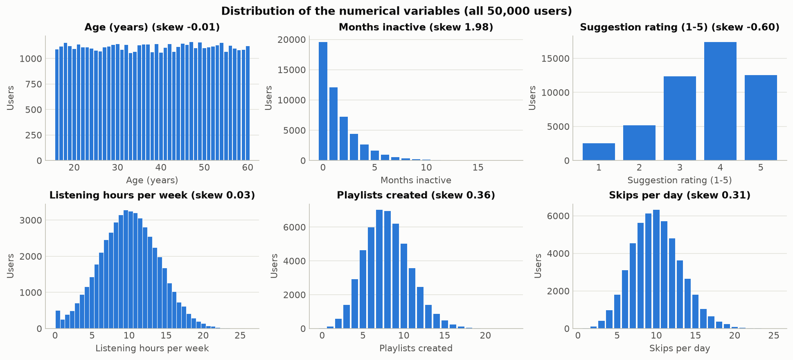
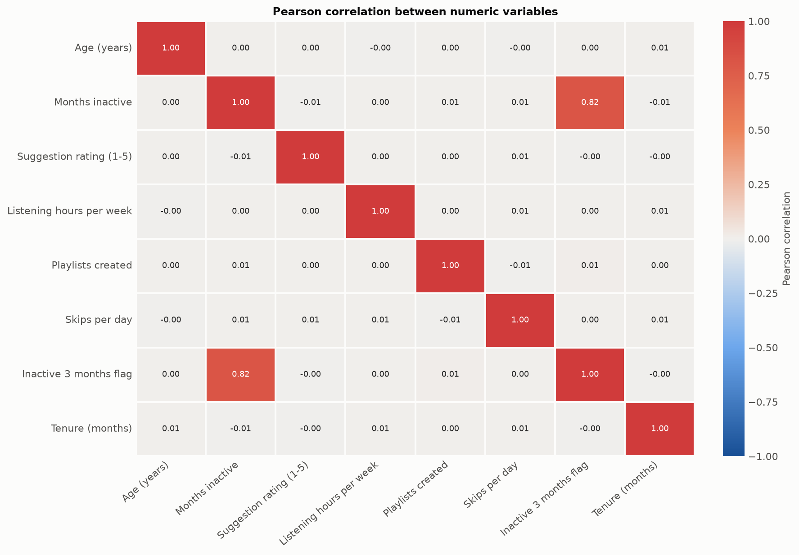
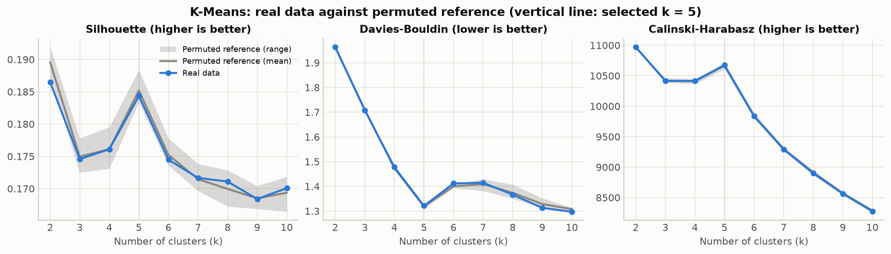
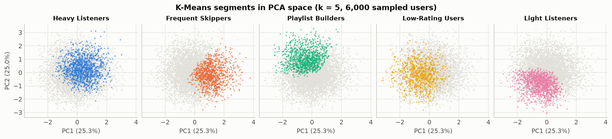
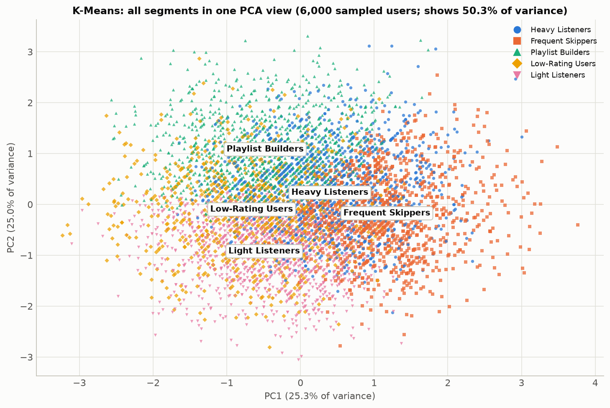
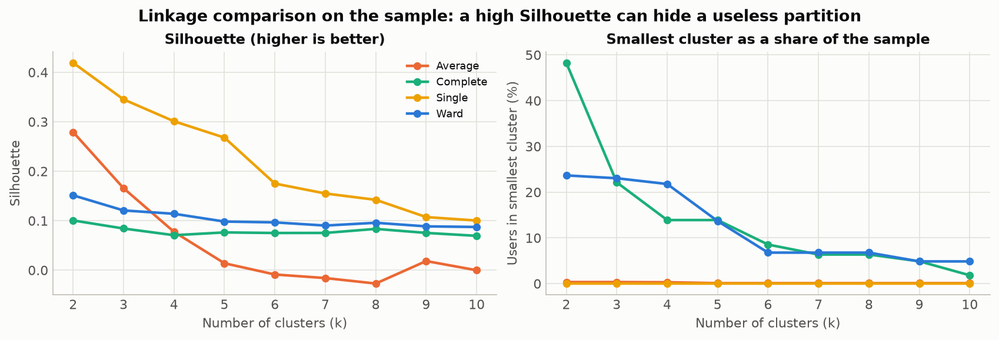
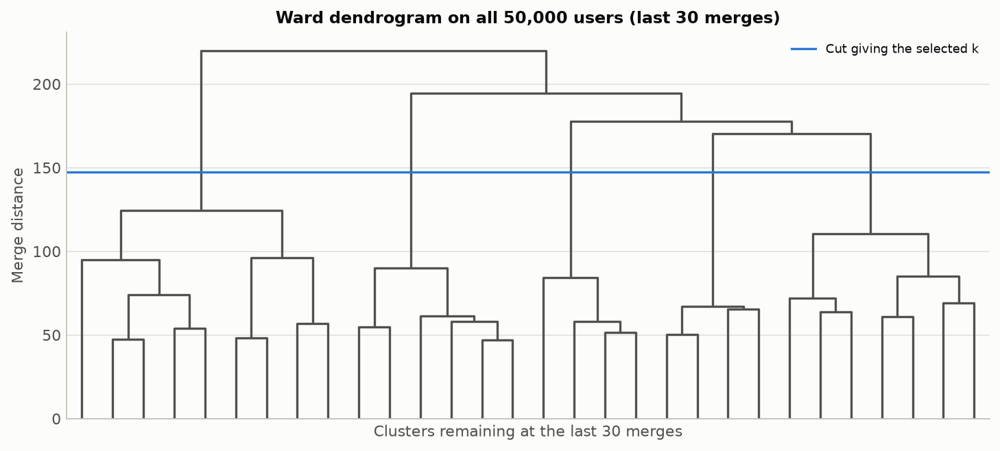
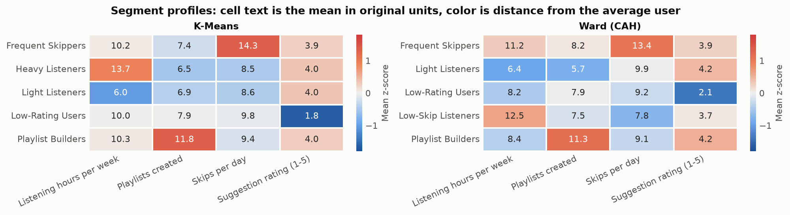
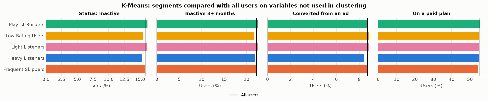
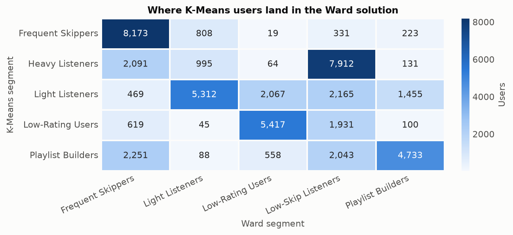

# Music Streaming User Segmentation: The Whole Project Explained

**Full title:** Music Streaming User Segmentation: A Comparative Study of K-Means and Agglomerative Hierarchical Clustering

This document explains what the project does, why each decision was made, what was found, and how to defend it in a presentation. You only need basic Python and machine learning to follow it. Every number comes from the executed notebooks and the files in `results/`.

---

## 1. The project in one minute

**Question:** can K-Means and Agglomerative Hierarchical Clustering (CAH) find meaningful, interpretable groups of users on a music streaming platform?

**What was done:** 50,000 synthetic users were clustered on four behavioural features: listening hours, playlists created, skips per day and music suggestion rating. Both algorithms were run on all users and compared with the same metrics.

**Answer: partly.**

- **Interpretable: yes.** Both algorithms give five segments that are easy to describe, such as Heavy Listeners and Frequent Skippers.
- **Natural groups: no evidence.** The same scores appear on data that has been shuffled so it cannot contain real groups.
- **Meaningful beyond the inputs: no.** Segments are unrelated to inactivity, subscription plan, ad conversion, age, or anything else the algorithms did not see.

**Recommendation:** if a descriptive segmentation is needed, use K-Means with k = 5. Present its segments as summaries of where users sit on four features, not as discovered types of people.

**Main lesson:** a clustering algorithm always returns clusters, even from data with no groups. Results should be compared with a structureless reference before being called a discovery.

---

## 2. The dataset

The data is one CSV file with **50,000 users and 18 columns**. It is synthetic, and it has no data dictionary, so column meanings are inferred from names and values. The original file name mentions Spotify, but this is simulated data and says nothing about real Spotify users.

| Group | Columns |
|---|---|
| Identifier | `user_id` |
| Demographics | `age`, `country` |
| Account | `signup_date`, `subscription_type`, `subscription_status` |
| Inactivity | `months_inactive`, `inactive_3_months_flag` |
| Advertising | `ad_interaction`, `ad_conversion_to_subscription` |
| Behaviour | `avg_listening_hours_per_week`, `playlists_created`, `avg_skips_per_day` |
| Opinion | `music_suggestion_rating_1_to_5`, `most_liked_feature`, `desired_future_feature` |
| Preference | `favorite_genre`, `primary_device` |

The project brief mentioned possible `engaging_score` and `engaging_level` columns. They do not exist in this file, so nothing uses them.

---

## 3. How the project is organized

```text
music-streaming-user-segmentation/
├── PROJECT_EXPLANATION.md     This document
├── README.md                  Project overview and how to run it
├── config/config.yaml         Features, seeds and model settings, in one place
├── data/
│   ├── raw/                   Original CSV (music_streaming_users.csv)
│   └── processed/             Cleaned table and scaled feature matrices
├── notebooks/                 The six notebooks, to run in order
├── src/                       Reusable code used by the notebooks
│   ├── data_loader.py         Loads the config and data
│   ├── preprocessing.py       Cleaning checks, features, scaling
│   ├── clustering.py          K-Means, Ward, segment naming
│   ├── evaluation.py          Metrics, reference test, stability, profiles
│   └── visualization.py       All plots, in one consistent style
├── scripts/                   Redraws the presentation charts with French labels
└── results/
    ├── figures/               27 saved charts
    ├── figures_fr/            French charts used in the presentation
    ├── metrics/               Evaluation tables
    ├── cluster_profiles/      Labels, sizes and segment profiles
    └── reports/               Final report
```

| Notebook | Job |
|---|---|
| `01_data_understanding_and_eda` | Understand the data and check its quality |
| `02_data_cleaning_and_preprocessing` | Choose features and prepare them for distance calculations |
| `03_kmeans_clustering` | Choose k, fit K-Means, test it |
| `04_hierarchical_clustering` | Compare linkages, fit Ward on all users, test it |
| `05_model_comparison_and_cluster_profiling` | Compare the algorithms and describe the segments |
| `06_final_analysis_and_conclusions` | Answer the question and verify all saved results |

---

## 4. Step 1: Understanding the data (Notebook 01)

### Quality

Column by column, the data is very clean: no missing values, no duplicates, no spelling variants and no impossible values.

Across columns, some combinations look odd. They suggest that columns were generated separately rather than by simulating coherent users.

| Odd combination | Users | Share |
|---|---:|---:|
| Paid plan but interacted with ads (may be legitimate) | 9,647 | 19.29% |
| `Active` status despite 3+ months inactive | 3,232 | 6.46% |
| Student plan at age 30 or older (possible, not typical) | 3,099 | 6.20% |
| Marked as converted but still on the Free plan | 1,921 | 3.84% |
| Inactive for longer than their tenure (depends on an assumed date) | 854 | 1.71% |
| Zero listening hours but at least one skip per day | 327 | 0.65% |

**Decision: no rows were deleted.** Without a data dictionary, we cannot prove these are errors. Only the last row affects the clustering inputs, so its effect was tested separately (section 10).

### Distributions



- **Listening hours:** a bell shape around 10 hours per week, with a small spike at zero.
- **Playlists and skips:** the variance almost equals the mean (ratios 1.002 and 0.999), which is typical of a Poisson count.
- **Rating:** five levels, leaning towards high scores.
- **Age:** roughly uniform from 16 to 60.
- **Categories such as country, genre and device:** almost perfectly even, with no rare categories.

### The key finding: the variables are independent



Excluding the inactivity flag, **the largest correlation between any two numeric variables is 0.008**. Listening more says nothing about playlists, skips or ratings.

The only real dependencies are built into the outcome-like columns:

- `inactive_3_months_flag` is exactly `months_inactive >= 3`.
- `Inactive` status occurs only among flagged users (7,891 of 11,123).
- Ad conversion occurs only after ad interaction (4,352 of 17,486).

**Why this matters:** natural groups normally create relationships between features. If heavy listeners who build many playlists formed a group, hours and playlists would be correlated across the population. So this finding raised the central question of the project: is there anything here to discover?

---

## 5. Step 2: Preparing the data (Notebook 02)

K-Means and CAH both compare users by distance, so preprocessing decides what "similar users" means.

### Feature selection

**Representation A, the main one, uses four features:** `avg_listening_hours_per_week`, `playlists_created`, `avg_skips_per_day` and `music_suggestion_rating_1_to_5`.

| Left out | Reason |
|---|---|
| `user_id` | An identifier, not behaviour |
| `signup_date` | A raw date cannot enter a distance calculation |
| `months_inactive`, `inactive_3_months_flag`, `subscription_status`, `ad_conversion_to_subscription` | Outcome-like, or derived from an outcome |
| `ad_interaction` | The precondition of the conversion outcome |
| `subscription_type` | Commercial status, not behaviour |
| `age`, `country` | Demographics, not behaviour |
| `most_liked_feature`, `desired_future_feature` | Survey opinions, not behaviour |

**Why keep outcomes out?** This avoids data leakage. If inactivity were an input, finding a "high inactivity cluster" would be circular. Keeping it out means that any link found later between clusters and inactivity would be real evidence.

All of these columns are still used **after** clustering, to describe the segments.

### Engineered features

| Candidate | Finding | Decision |
|---|---|---|
| Account tenure | Unrelated to behaviour (r of 0.008 or less), and it relies on an assumed snapshot date (the latest signup, 2026-03-01) | Interpretation only |
| Skips per listening hour | Undefined for 327 users, maximum 8,400, skew 84.6, and made from features already included | Interpretation only |
| Composite engagement score | Cronbach's alpha is 0.005, so the features do not measure one shared thing | Not created |

### Transforming and scaling

**No `log1p`.** It compresses long right tails, but these features have none. It would make them worse: hours would go from skew 0.03 to -1.72. Note that a count has many ordered values, so a log can reshape it, while a binary 0/1 variable can only be rescaled, with no statistical benefit.

**StandardScaler** was chosen so that each feature has variance 1 and contributes equally. RobustScaler would leave unequal variances (0.31 for rating and 0.63 for skips) with no behavioural reason, and its main benefit, resistance to extreme outliers, is not needed here.

**Outliers were kept.** Under 1% of values per feature fall outside the IQR fences, and they are believable values for unusually active users, not mistakes.

**One assumption to state openly:** treating the rating as a number assumes the gap between 1 and 2 equals the gap between 4 and 5. Section 10 tests what happens without the rating.

### The mixed representation

**Representation B** adds one-hot encoded `favorite_genre` (12 levels) and `primary_device` (5 levels), for 21 columns in total. It is a comparison only.

- **Why not number the categories?** Pop = 1 and Rock = 2 would invent an order and distances that do not exist.
- **Why not standardize the dummy columns?** Each dummy would gain variance 1, so a 12-level genre would weigh about as much as 12 numeric features. Left as 0/1, genre has a total variance of 0.917 and device 0.800, close to the 1.0 of one numeric feature.

---

## 6. Step 3: K-Means (Notebook 03)

### How it works

1. Choose k starting centroids. A **centroid** is the average user of a cluster.
2. Assign every user to the nearest centroid.
3. Move each centroid to the mean of its users.
4. Repeat steps 2 and 3 until assignments stop changing.

**Settings:** `k-means++` spreads out the starting centroids, 20 restarts protect against a poor start, the seed is fixed at 42, and k runs from 2 to 10.

### The metrics

| Metric | Meaning | Better when |
|---|---|---|
| Inertia | Total squared distance from users to their centroid. It always falls as k rises, so we look for a bend | Bend in the curve |
| Silhouette | How much closer a user is to their own cluster than to the next one, from -1 to 1 | Higher |
| Davies-Bouldin | How similar each cluster is to its closest neighbour | Lower |
| Calinski-Harabasz | Between-cluster variance relative to within-cluster variance | Higher |

### Results across k

| k | Inertia drop | Silhouette | Davies-Bouldin | Calinski-Harabasz | Seed stability (ARI) |
|---:|---:|---:|---:|---:|---:|
| 2 | | **0.1865** | 1.963 | **10,970** | 0.376 |
| 3 | 13.9% | 0.1746 | 1.708 | 10,417 | 0.360 |
| 4 | 12.8% | 0.1761 | 1.478 | 10,415 | 0.608 |
| **5** | 12.4% | 0.1844 | 1.321 | 10,675 | **0.957** |
| 6 | 6.5% | 0.1745 | 1.412 | 9,837 | 0.579 |
| 7 | 6.2% | 0.1717 | 1.415 | 9,294 | 0.424 |
| 8 | 5.8% | 0.1711 | 1.366 | 8,900 | 0.338 |
| 9 | 5.2% | 0.1684 | 1.313 | 8,564 | 0.358 |
| 10 | 4.8% | 0.1701 | **1.297** | 8,273 | 0.409 |

Silhouette is computed on the same 10,000 users for every k. The other metrics use all users.

**Why k = 5?**

- It is at the elbow: the inertia drop falls from 12.4% to 6.5% right after it.
- Its Silhouette is close to the best, and it has clear local bests on Davies-Bouldin and Calinski-Harabasz.
- It has by far the highest seed stability.
- Every behavioural feature defines a cluster, which makes it informative.

**Why not k = 2, which has the best Silhouette?** Only the rating differs between its clusters (2.49 versus 4.42). Hours, playlists and skips are the same in both, so it just separates low raters from everyone else.

**"Selected" means the most useful description, not the true number of groups.** Every Silhouette value is below 0.2, and a common rule of thumb treats anything below 0.25 as showing no substantial structure.

---

## 7. The most important test: could this just be chance?

Metrics can rank candidates, but they cannot tell us whether **any** candidate reflects real groups. So this test, an addition to the original plan, asks: **would we get the same scores from data that cannot contain groups?**

**How it works:** shuffle each column independently. Each feature keeps exactly the same distribution, but all links between features are destroyed: a user's playlists no longer have anything to do with their listening hours. This was repeated with 10 different shuffles.

- If real scores clearly beat the shuffled scores, features combine in ways that form groups.
- If they match, the partitions reflect only the shape of each individual feature.



**The blue line (real) sits on top of the gray band (shuffled).** Even the peak at k = 5 appears in shuffled data.

| At k = 5 | Real | Shuffled mean | Shuffled range |
|---|---:|---:|---:|
| **K-Means** Silhouette | 0.1844 | 0.1852 | 0.1834 to 0.1884 |
| **K-Means** Davies-Bouldin | 1.3209 | 1.3186 | 1.3094 to 1.3238 |
| **K-Means** Calinski-Harabasz | 10,675 | 10,667 | 10,612 to 10,712 |
| **Ward** Silhouette | 0.1037 | 0.1099 | 0.1016 to 0.1219 |
| **Ward** Davies-Bouldin | 1.6308 | 1.6690 | 1.5727 to 1.7731 |
| **Ward** Calinski-Harabasz | 7,238 | 7,356 | 6,867 to 8,067 |

**Across all 54 combinations** of algorithm, k and metric, 46 fall inside the shuffled range, 2 are better than every shuffle, and 6 are worse. If the real data behaved like one more shuffle, about 2 in 11 (about 10 of 54) would fall outside the range by chance. We observed 8. Results at different k are related, so this is a rough guide rather than a formal test, but the message is clear.

A second reference, a single random 4-dimensional Gaussian blob, gives a Silhouette of 0.166 at k = 5. So a weak score of this size is achievable with one cloud and no groups at all.

### PCA picture



PCA is used only for drawing: clustering happened in the full four dimensions. The four components explain 25.3%, 25.0%, 25.0% and 24.7% of the variance, so this plot shows only **50.3%** of the information. Even so, it fits the other evidence: one continuous cloud, with no gaps between segments.

The same view is also available with all segments on one chart:



The Ward version is `results/figures/cah_pca_all_segments.png`.

### Why do clusters seem to overlap if each user goes to the nearest centroid?

**No user belongs to two clusters: every user has exactly one label.** The overlap you see has three causes:

1. **The chart is a shadow of four dimensions.** Two users can land on almost the same spot while being far apart in the two hidden dimensions, like two planes at different altitudes whose shadows touch. For example, these users are nearly identical on the chart but very different in reality:

   | | Hours per week | Playlists | Skips per day | Rating | PC1 | PC2 |
   |---|---:|---:|---:|---:|---:|---:|
   | Playlist Builder | 7.67 | 16 | 12 | 3 | -1.07 | 1.74 |
   | Low-Rating User | 14.09 | 12 | 8 | 2 | -1.08 | 1.70 |

   Among sampled pairs of users that almost touch on the chart, 56.8% are in different K-Means clusters, with a median real distance of 2.15 standard deviations.

2. **Only K-Means uses the nearest-centroid rule.** Ward builds clusters from merges and never reassigns users, so some users end up closer to another cluster's mean.

   | Users nearest to their own cluster's centre | K-Means | Ward (CAH) |
   |---|---:|---:|
   | In the real 4D space | 100% | 74.59% |
   | On the 2D chart | 55.13% | 52.11% |

3. **The cloud is continuous.** There is no empty space between clusters, so users on either side of a boundary can be very similar, even in four dimensions.

The K-Means figure refers to the model's final centroids. Means recomputed from the final labels give 99.93%, because the algorithm stops once changes become negligible.

---

## 8. Step 4: Hierarchical clustering, CAH (Notebook 04)

### How it works

Start with each user as their own cluster, then repeatedly merge the two closest clusters until one remains. The result is a tree called a **dendrogram**. Cutting it at a chosen height gives a partition, and merges are never undone.

| | K-Means | CAH |
|---|---|---|
| Decisions | Revisable at each step | Final once made |
| k | Chosen before fitting | Chosen afterwards, by cutting the tree |
| Randomness | Depends on starting points | Deterministic for a given data order |
| New users | Assign to nearest centroid | No built-in method |

### The computational problem and its solution

The textbook method stores the distance between every pair of users. For 50,000 users, that is 1.25 billion distances, or **10 GB** before any clustering starts. The machine used has 14 GB in total, with about 5 GB free when the project was built.

Ward linkage has a vector-based algorithm that needs no distance matrix. Using the `fastcluster` library, **all 50,000 users took about 5 seconds**. On a sample, it gave partitions identical to SciPy and scikit-learn (ARI = 1.0), so it changes the efficiency and not the method.

As a result, **K-Means and CAH are compared on exactly the same 50,000 users**, with no extrapolation from a sample. `AgglomerativeClustering` has no `predict` method, so extending a sample to everyone would have needed a separate rule, and it would not have been good enough: a 5,000-user Ward solution extended to everyone agrees with the full solution at an ARI of only 0.334.

### Choosing the linkage

Linkages were compared on a reproducible sample of 5,000 users, with means and standard deviations close to the full data. This comparison describes the sample and is not proof about the full dataset.



- **Single (saut minimal): rejected.** It has the highest Silhouette of all (0.419 at k = 2, 0.268 at k = 5), but at k = 5 one cluster holds 4,996 of 5,000 users and the other four hold one user each. This is a good example of why a metric cannot be read without looking at cluster sizes.
- **Average: rejected.** It fails in a similar way: Silhouette 0.279 at k = 2, with one cluster holding 99.7% of users.
- **Complete (saut maximal): rejected.** Its clusters are usable, but its Silhouette is below Ward's at every k.
- **Ward: selected.** It is balanced, has the best usable Silhouette, and is feasible on all users.

Ward and K-Means both minimize within-cluster variance, so they are related methods, and their agreement is not fully independent confirmation.

### Choosing k = 5



| k | Silhouette | Davies-Bouldin | Calinski-Harabasz | Subsample stability |
|---:|---:|---:|---:|---:|
| 2 | **0.1328** | 2.214 | 6,873 | 0.272 |
| 3 | 0.1104 | 2.064 | 6,858 | 0.286 |
| 4 | 0.0995 | 1.842 | 6,948 | 0.297 |
| **5** | 0.1037 | **1.631** | **7,238** | **0.350** |
| 6 | 0.1013 | 1.753 | 6,821 | 0.322 |
| 7 | 0.0952 | 1.820 | 6,440 | 0.305 |
| 8 | 0.0827 | 1.694 | 6,060 | 0.304 |
| 9 | 0.0813 | 1.670 | 5,806 | 0.294 |
| 10 | 0.0723 | 1.668 | 5,596 | 0.290 |

k = 5 has the best Davies-Bouldin, Calinski-Harabasz and stability on real data, and clear profiles on all four features. It was chosen on its own evidence, not to match K-Means.

**A dendrogram gap is not proof.** The biggest relative jump occurs just after k = 5: going from 6 to 5 clusters costs 124.6, and going from 5 to 4 costs 170.3 (ratio 1.37). A traditional reading would call this a natural cut. But shuffled data shows the same jump (ratios of 1.27, 1.13 and 1.47), one of them larger than the real value.

---

## 9. Step 5: The segments (Notebook 05)

Each segment is named by a mechanical rule, so names trace back to data: **the feature where the segment is furthest from the average user, and the direction.**

Average user: **9.99 hours per week, 8.00 playlists, 10.03 skips per day, rating 3.64.**



Numbers in the cells are means in original units. Color only shows distance from the average user.

### K-Means segments

| Segment | Users | Share | Evidence |
|---|---:|---:|---|
| **Light Listeners** | 11,468 | 22.94% | 6.02 hours per week |
| **Heavy Listeners** | 11,193 | 22.39% | 13.68 hours per week |
| **Playlist Builders** | 9,673 | 19.35% | 11.78 playlists |
| **Frequent Skippers** | 9,554 | 19.11% | 14.28 skips per day |
| **Low-Rating Users** | 8,112 | 16.22% | Rating of 1.83 |

### Ward segments

| Segment | Users | Share | Evidence |
|---|---:|---:|---|
| **Low-Skip Listeners** | 14,382 | 28.76% | 7.79 skips per day, and above-average 12.46 hours |
| **Frequent Skippers** | 13,603 | 27.21% | 13.41 skips per day |
| **Low-Rating Users** | 8,125 | 16.25% | Rating of 2.11 |
| **Light Listeners** | 7,248 | 14.50% | 6.39 hours, and few playlists (5.71) |
| **Playlist Builders** | 6,642 | 13.28% | 11.29 playlists |

Differences on these four features are **guaranteed by construction**, because clustering worked directly on them. They do not prove anything by themselves. "Low-Rating Users" rate music suggestions low on average; that alone does not show dissatisfaction with the whole service or a risk of leaving.

### The real test: do segments differ on anything else?

Variables the algorithms never saw are the fair test. This is also the proper role of the outcome columns: description after clustering, not model selection.



| Variable, for K-Means | Lowest segment | Highest segment | All users |
|---|---:|---:|---:|
| `Inactive` status | 15.38% | 16.19% | 15.78% |
| Inactive 3+ months | 21.77% | 22.63% | 22.25% |
| Converted from an ad | 8.42% | 8.84% | 8.70% |
| On a paid plan | 54.48% | 55.38% | 54.95% |

Across 26 tests covering both algorithms:

- The largest effect size is Cramér's V = 0.0145.
- **No test is significant**, even at the uncorrected 5% level (smallest p-value 0.17).

**So no segment can be tied to churn, dissatisfaction or subscription conversion.** Low-Rating Users are no more likely to be inactive than anyone else.

---

## 10. Step 6: Comparing the algorithms (Notebook 05)

### Scores, on the same users, features and k

| Criterion | K-Means | Ward CAH | Better |
|---|---:|---:|---|
| Silhouette, all users | 0.186 | 0.103 | K-Means |
| Davies-Bouldin | 1.321 | 1.631 | K-Means |
| Calinski-Harabasz | 10,675 | 7,238 | K-Means |
| Better than shuffled data? | No | No | Neither |
| Cluster sizes | 16.2% to 22.9% | 13.3% to 28.8% | K-Means |
| Subsample stability (ARI) | 0.801 | 0.350 | K-Means |
| Same stability on shuffled data | 0.765 | 0.368 | |
| Fit time, all users | about 1.6 s | about 5 s | Similar (machine-dependent) |

**ARI**, the Adjusted Rand Index, measures agreement between two partitions: 1 means identical and 0 means no better than chance.

K-Means is expected to win on variance-based metrics, since it directly optimizes that quantity, while Ward's early merges are never revisited.

Ward's weakest segment shows the difference clearly. Its Frequent Skippers have a mean silhouette of just 0.016, and **45.8% of them are closer to another segment**. For K-Means, the worst figure is 10.1%.

### Do they agree?

**Only moderately: ARI 0.306.** Same-named segments overlap only partly (Jaccard from 0.40 to 0.55), although 8,173 of the 9,554 K-Means Frequent Skippers (85.5%) also land in Ward's segment of that name.



Both methods minimize variance, but K-Means keeps revising assignments while Ward's merges are permanent. With no natural boundaries to converge on, each method's cuts follow its own mechanics.

### Stability is not proof either

K-Means at k = 5 is very repeatable, but it is just as repeatable on shuffled data (0.801 versus 0.765). So this says that K-Means has a reliable way to slice this *shape* of cloud, not that the slices are natural groups. Centroids being almost equally spaced (distances from 1.935 to 2.371) fits this picture of slicing one cloud.

### How much do analyst choices matter?

Each decision was changed once, the model was re-fitted, and the result was compared with the baseline. Lower ARI means more of the partition changed.

| Change | K-Means ARI | Ward ARI |
|---|---:|---:|
| RobustScaler instead of StandardScaler | 0.462 | 0.181 |
| Remove the rating feature | 0.459 | 0.156 |
| Exclude 327 zero-hour users (0.65%) | 0.926 | **0.234** |
| Add genre and device (Representation B) | 0.963 | **0.119** |
| k = 4 instead of 5 | 0.568 | 0.803 |
| k = 6 instead of 5 | 0.627 | 0.890 |

- **Scaling and feature choice change the answer substantially** for both.
- **Ward is fragile:** removing 0.65% of users changes most of its partition.
- **Ward has one advantage:** its partitions are nested, so changing k only splits or merges one cluster.
- **Representation B adds nothing useful:** K-Means nearly ignores the new columns, while Ward follows them (device shares differ by up to 32.8 percentage points). Representation A remains the final basis.
- **The preferred k moves too:** without the rating, all three metrics favour k = 4 for K-Means. A real count of user groups should not change so easily.

---

## 11. The final answer

> **Can K-Means and CAH identify meaningful and interpretable user behaviour segments?**
>
> **Partly. Both produce interpretable segments, but the evidence does not show that they are natural or meaningful groups in this dataset.**

| Claim | Verdict | Evidence |
|---|---|---|
| Segments can be understood and named | **Yes** | Clear profiles in original units |
| Users form natural groups | **No evidence** | Silhouette below 0.2; scores, stability and the dendrogram gap are all matched by shuffled data |
| Segments relate to other variables | **No** | Largest effect 0.0145; 0 of 26 tests significant |
| One algorithm is better for description | **K-Means** | Better scores, balance, stability and interpretability |

This is a successful result, even though it is not the most exciting one. A naive version of this project would have stopped at the five named segments and presented them as discoveries. Including a reference test is what prevented that mistake.

---

## 12. Limitations

- **Synthetic data:** the findings apply to this file, not to real streaming users. Real behaviour would be expected to show correlations that this data lacks.
- **No ground truth:** there are no true segment labels, so accuracy cannot be measured.
- **Internal metrics are limited:** they favour round, compact clusters and can reward useless partitions, as single linkage showed.
- **The reference test has limits:** shuffling tests only for structure between features, and 10 datasets give a range, not a precise p-value.
- **Sensitivity:** results depend heavily on scaling and feature selection.
- **The rating is ordinal,** but it was treated as numeric.
- **PCA shows only 50.3% of the variance,** so the 2D plots are illustrations.
- **CAH limits:** the vector shortcut exists only for some linkages, so the linkages were compared on a sample, and average and complete linkage were not run on all users.
- **Assumptions:** column meanings and the tenure snapshot date are inferred.
- **Reproducibility:** seeds are fixed, but very small K-Means differences are possible on machines with a different thread count or library versions.

## 13. Future work

1. **Run the same pipeline on real user data.** This is the most important next step.
2. **Add a method that can conclude "no clusters",** such as a Gaussian mixture model compared by BIC, including the one-component option.
3. **Try richer features,** such as session-level data, or Gower distance for mixed data.
4. **Try a density-based method** such as HDBSCAN, which can leave points unassigned.
5. **Study segments over time,** if temporal data becomes available.
6. **Obtain a data dictionary,** to resolve the odd column combinations.

---

## 14. Presenting the project

### Slide order

The deck has 16 slides, with speaker notes on each one. The split below is a suggestion for 3 presenters.

| # | Slide | Presenter | Main point | Figure |
|---:|---|---|---|---|
| 1 | Title | 1 | Introduce the team and the topic | |
| 2 | Research question | 1 | Clustering always returns clusters, so we test them | |
| 3 | The dataset | 1 | 50,000 synthetic users, 18 columns, clean | `eda_numeric_distributions.png` |
| 4 | Key finding | 1 | Features are almost perfectly independent | `eda_correlation_heatmap.png` |
| 5 | Preparing the data | 1 | Four features, no leakage, standardized | |
| 6 | K-Means | 2 | k = 5 is the best balance of evidence | `kmeans_elbow.png` |
| 7 | Choosing the CAH linkage | 2 | Why Ward rather than saut minimal or saut maximal | `results/figures_fr/cah_linkage_choice.png` |
| 8 | CAH | 2 | Ward on all users via `fastcluster`; k = 5 | `cah_ward_dendrogram_full.png` |
| 9 | The segments | 2 | Five clear profiles | `comparison_profile_heatmaps.png` |
| 10 | All clusters on one chart | 2 | Each user has one label; the overlap comes from the chart | `kmeans_pca_all_segments.png`, `cah_pca_all_segments.png` |
| 11 | K-Means against Ward | 3 | K-Means is better on every internal metric | |
| 12 | The shuffle test | 3 | Real scores match shuffled data | `kmeans_metrics_vs_reference.png` |
| 13 | External test | 3 | Segments do not relate to outcomes | `comparison_external_rates_kmeans.png` |
| 14 | Our answer | 3 | Interpretable, but not natural groups | |
| 15 | Limitations and next steps | 3 | Synthetic data; validate on real data | |
| 16 | Thank you | All | Questions | |

### Questions you may be asked

**Why is your Silhouette so low? Did you do something wrong?**
No. The features are independent, so there is one continuous cloud and no real separation to measure. The shuffled data gets the same score, which shows the low value comes from the data and not from the pipeline.

**If there are no natural clusters, is the project a failure?**
No. The goal was to find out whether meaningful segments exist, and the project answered that with evidence. Reporting named segments as discoveries would have been the real failure.

**Why shuffle the columns?**
It keeps each feature's distribution but removes all relationships between features. So it shows what scores are possible when no joint groups can exist.

**Why not use `subscription_status` or `months_inactive` in the clustering?**
That would be data leakage. They are outcome-like, so clusters would partly reflect them by construction, and any later link to inactivity would be circular. They were used only after clustering.

**Why k = 5 when Silhouette prefers k = 2?**
At k = 2, only the rating differs between clusters. k = 5 is nearly as good on Silhouette, better on stability and Davies-Bouldin, and much more informative. No single metric decided it. It is the most useful description, not a true number of groups.

**Hierarchical clustering does not scale. How did you run it on 50,000 users?**
The standard method would need 10 GB for the distance matrix. Ward has a vector-based algorithm that needs no matrix, and `fastcluster` ran it in about 5 seconds. On a sample, it matched SciPy and scikit-learn exactly.

**Why does single linkage have the best Silhouette, yet you rejected it?**
At k = 5, one cluster holds 4,996 of the 5,000 sampled users and the other four hold one user each. A high score with a useless partition shows why metrics must be read together with cluster sizes.

**K-Means is so stable at k = 5. Doesn't that prove the clusters are real?**
No. It is almost as stable on shuffled data (0.801 versus 0.765). Stability shows the method is repeatable, not that the groups exist.

**Your clusters overlap on the chart. Doesn't that mean users are in two clusters?**
No. Each user has exactly one label. The chart shows only 50.3% of the variance, so users far apart in four dimensions can land on the same spot. In the real 4D space, 100% of K-Means users are nearest to their own final centroid. Ward does not use that rule, so the figure for Ward is 74.59%.

**Why StandardScaler and not RobustScaler?**
Outliers are rare and believable, so robustness is not needed, and StandardScaler gives each feature equal weight. The choice does matter, though: switching changes the K-Means partition substantially (ARI 0.462), and this is reported as a limitation.

**What would you tell a company using this?**
These segments are fine as simple summaries, such as "users with high listening hours". They should not be used to target churn or conversion, because they have no relationship with either in this data. And the analysis should be repeated on real data.

---

## 15. Running the project

The project was built and tested with Python 3.12. Exact package versions are in `requirements.txt`.

```bash
python3.12 -m venv .venv
source .venv/bin/activate
pip install -r requirements.txt

# The dataset must be at data/raw/music_streaming_users.csv

jupyter nbconvert --to notebook --execute --inplace notebooks/0*.ipynb
```

Or run `jupyter lab` and execute the notebooks in order, from 01 to 06. A full run took about 14 minutes on a 16-core machine, mostly the reference tests in Notebooks 03 and 04. Notebook 06 ends with a series of checks that recompute results from saved files and stop with an error if anything is inconsistent.

To change features, seeds or the selected k, edit `config/config.yaml`. The written interpretations in the notebooks describe the current results, so they would need updating after such a change.

---

## 16. Glossary

| Term | Meaning |
|---|---|
| **ARI** | Adjusted Rand Index: agreement between two partitions, where 1 is identical and 0 is chance level |
| **CAH** | Classification Ascendante Hiérarchique, the French name for agglomerative hierarchical clustering |
| **Centroid** | The mean of all users in a cluster |
| **Cramér's V** | Strength of association between two categorical variables, from 0 to 1 |
| **Cronbach's alpha** | How strongly several variables move together as one score |
| **Data leakage** | Letting information about an outcome enter the model's inputs |
| **Dendrogram** | The tree of merges produced by hierarchical clustering |
| **Eta squared** | Share of a numeric variable's variance explained by a grouping |
| **One-hot encoding** | Turning a category into separate 0/1 columns |
| **PCA** | Finds new axes capturing the most variance; used here for plots only |
| **Permuted (shuffled) reference** | Data with each column shuffled independently, so no joint structure can exist |
| **Ward linkage** | Merges the two clusters that increase within-cluster variance the least |
| **z-score** | Distance from the mean, in standard deviations |
